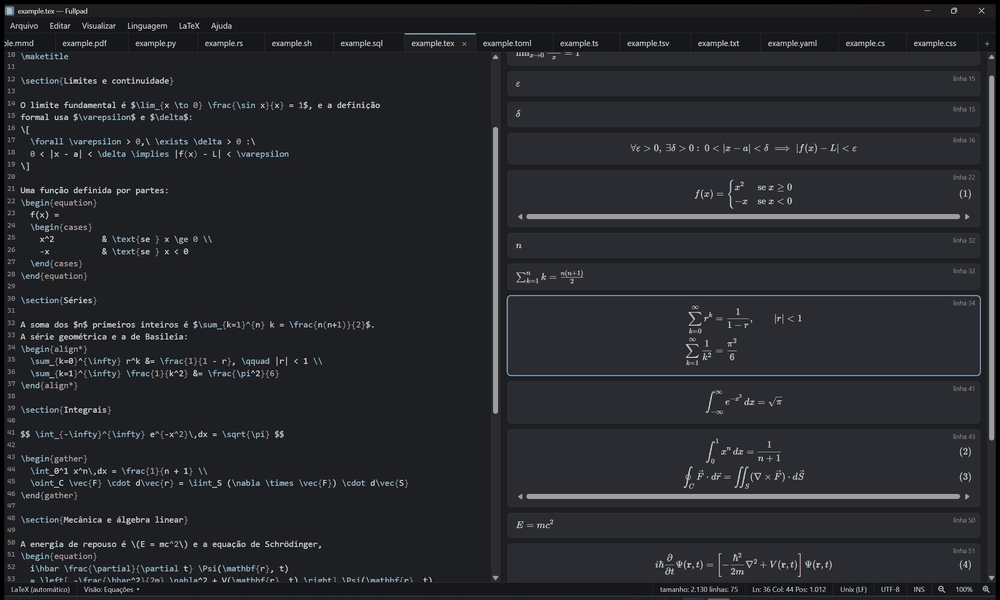
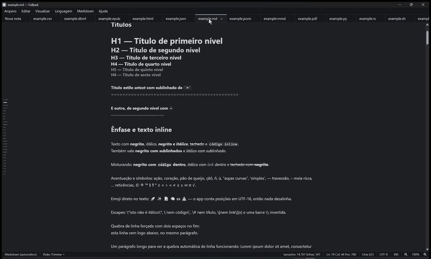
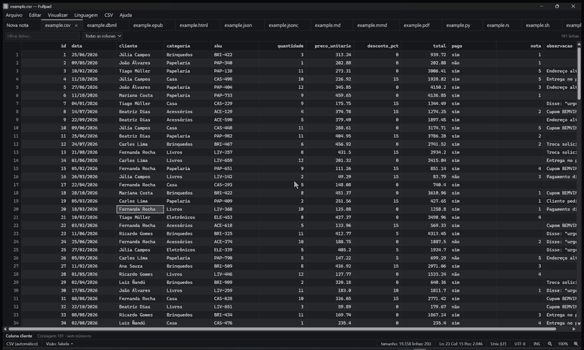
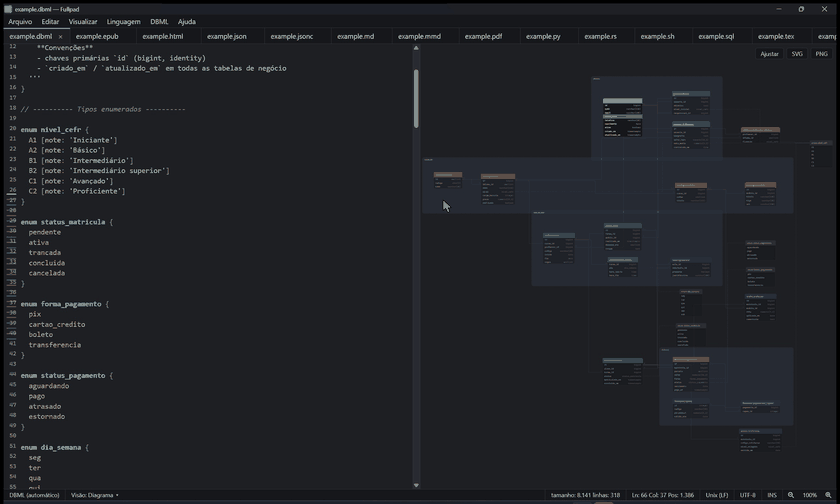
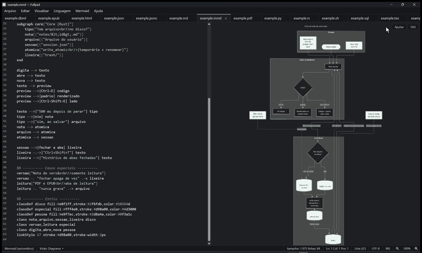
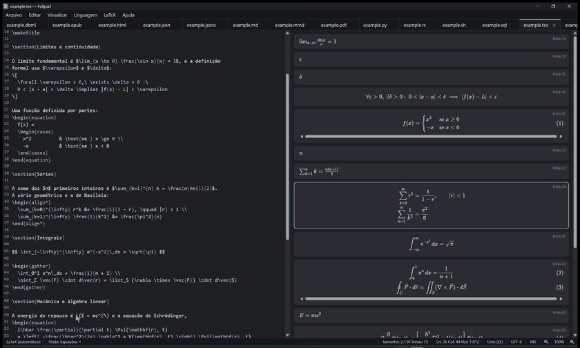

# Fullpad

Editor de notas e markdown **rápido**, no estilo do Notepad++: **nada se perde ao fechar**. O markdown é renderizado e continua editável (*live preview*), e arquivos de dados, diagramas, equações, PDF e EPUB abrem do jeito que fazem sentido para cada tipo. Feito com Rust, Tauri 2 e CodeMirror 6.



<!--
  Galeria: gere os GIFs com `scripts/gifs/gravar.sh` (veja o cabeçalho do script), confira os quadros
  e tire este comentário. Cada linha abaixo mostra um recurso:







-->

## O que ele faz

- **Nada se perde.** Abas, notas e posição de cada janela voltam como estavam. Fechar uma aba a guarda no histórico (Ctrl+Shift+T reabre). Toda gravação é atômica, e salvar um arquivo nunca sobrescreve uma mudança feita por outro programa sem perguntar.
- **Markdown de verdade**: *live preview* editável (títulos, listas, tarefas, código com destaque), barra de formatação sobre a seleção (negrito, itálico, link, equação...), diagramas **Mermaid** e equações **LaTeX** (`$...$` e `$$...$$`) desenhados no próprio texto, sumário lateral e exportação para HTML e PDF.
- **Dados com visão própria**: **JSON**, **YAML** e **TOML** em árvore ao lado do código (com validação, links e miniaturas), **CSV/TSV** como tabela (ordenar, filtrar, editar célula, colar do Excel, estatísticas da seleção), **DBML** e **Mermaid** como diagrama, **LaTeX** como as equações soltas do arquivo.
- **Leitura**: **PDF** e **EPUB** em abas só de leitura, com busca no documento, citação em markdown e a posição de leitura lembrada por arquivo. O arquivo nunca é gravado, e o conteúdo abre sem scripts nem rede.
- **Janelas e painéis**: várias janelas, painéis lado a lado ou empilhados (como no VS Code), arrastar abas entre painéis e janelas, visão em janela separada.
- **Paleta de um campo só** (Ctrl+P): arquivos abertos, fechados e recentes, `:42` para ir à linha, `@` para títulos e símbolos, `>` para todos os comandos dos menus. **Busca global** nas abas (Ctrl+Shift+F), localizar e substituir com regex, zoom da janela inteira.
- **Destaque de sintaxe** para dezenas de linguagens (JS, TS, Python, Rust, SQL, YAML, Shell, C#, Go, Kotlin...), carregado sob demanda.
- **Atualização automática** assinada, com a nota de versão aberta depois de atualizar.

A lista completa, com as decisões por trás de cada recurso, está em [`docs/AGENTS.md`](docs/AGENTS.md). Para ver tudo funcionando, abra os arquivos da pasta [`examples/`](examples/).

## Instalar

**Windows 10/11**: baixe o instalador `Fullpad_<versão>_x64-setup.exe` na [última versão](https://github.com/Brennon-Oliveira/fullpad-releases/releases/latest). A instalação é por usuário (não pede administrador) e o app se atualiza sozinho depois.

> **Aviso do SmartScreen.** O instalador **não tem assinatura de código do Windows** (isso custa um certificado pago), então na primeira execução o Windows mostra "O Windows protegeu o computador / editor desconhecido". Clique em **Mais informações → Executar assim mesmo**. As atualizações automáticas, essas sim, são assinadas por uma chave própria do projeto e o app só aceita as que conferem. O código é aberto: você pode compilar o instalador você mesmo.

**Linux**: ainda não há pacote; compile do código-fonte (abaixo).

**macOS**: ainda não é suportado.

Os dados ficam em `%APPDATA%\fullpad` (Windows) e `~/.local/share/fullpad` (Linux). `FULLPAD_DATA_DIR=/algum/lugar` sobrescreve (bom para testar sem mexer nas suas notas). Desinstalar **não apaga as suas notas**: elas ficam nessa pasta.

## Compilar e desenvolver

Pré-requisitos: [Rust](https://rustup.rs), [Node](https://nodejs.org) e [pnpm](https://pnpm.io).

- **Windows**: WebView2 (já vem no Win10/11) e o Build Tools do Visual Studio (MSVC).
- **Linux**: `sudo apt install libwebkit2gtk-4.1-dev libgtk-3-dev libayatana-appindicator3-dev librsvg2-dev pkg-config build-essential`

```sh
cargo install tauri-cli --version "^2" --locked     # uma vez
pnpm --dir ui install
cd crates/app
cargo tauri dev                                     # desenvolvimento
cargo tauri build                                   # instalador / binário
```

Testes (na raiz do repositório):

```sh
cargo test -p fullpad-core                          # testes do core
pnpm --dir ui exec vitest run                       # testes da interface
pnpm --dir ui build                                 # tsc --noEmit + vite build
```

O `.exe` de Windows do mantenedor sai por cross-compile no WSL (veja [`docs/rules/build-windows.md`](docs/rules/build-windows.md)). Ainda não há pipeline no GitHub: os testes rodam localmente.

## Estrutura

```
crates/core   persistência (sessão, notas, escrita atômica, lixeira), parsers, busca. Sem UI, testável
crates/app    Tauri 2: comandos IPC, janelas, instância única, atualização automática
ui/           TypeScript + CodeMirror 6 + Vite: abas, editor, live preview, menus
examples/     um arquivo de exemplo por tipo suportado
docs/         arquitetura, regras do projeto e roteiro
```

## Contribuir

Contribuições são bem-vindas: bugs, ideias, documentação, exemplos e código. Leia o [`CONTRIBUTING.md`](CONTRIBUTING.md) (ambiente, fluxo, regras de código, formato dos commits). Bugs e ideias vão nas [issues](https://github.com/Brennon-Oliveira/fullpad/issues); o ranking do que vem primeiro está na issue fixada "Ranking de prioridades". O roteiro de entrega está em [`docs/PLANO.md`](docs/PLANO.md).

Encontrou uma vulnerabilidade? Não abra issue pública: veja a seção [Segurança](CONTRIBUTING.md#segurança).

## Licença

O Fullpad é distribuído sob a licença **MIT** (veja [`LICENSE`](LICENSE)). As bibliotecas de terceiros que ele usa e as licenças delas estão em [`THIRD_PARTY_LICENSES.md`](THIRD_PARTY_LICENSES.md) (arquivo gerado por `scripts/gerar-licencas.py`; também vai junto do instalador).
