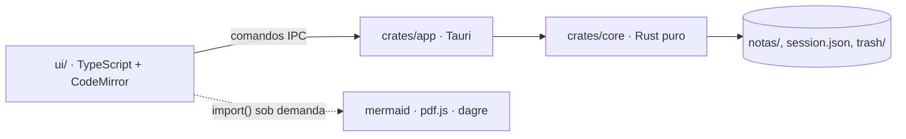

# AGENTS.md — Fullpad

Guia para agentes (e pessoas) que mexem neste repositório. Leia antes de alterar código: **o que está aqui vale mais que o palpite**, e o que não está aqui fica nas [issues](https://github.com/Brennon-Oliveira/fullpad/issues).

> **Promessa do produto:** nada se perde ao fechar. Qualquer mudança que ponha texto do usuário em risco é um bug, mesmo que os testes passem.

---

## Visão geral

Fullpad é um editor de notas e markdown rápido, no estilo Notepad++, com *live preview*. Rust + Tauri 2 + CodeMirror 6.



| Pasta | O que vive nela | Pode depender de |
| --- | --- | --- |
| `crates/core` | persistência, parsers (JSON, YAML, TOML, CSV, EPUB), busca | nada de UI nem de Tauri |
| `crates/app` | comandos IPC, janelas, atualização automática | `core` |
| `ui/` | abas, editor, menus, painéis renderizados | só `api.ts` fala com o Rust |
| `examples/` | um arquivo por tipo suportado | — |
| `docs/` | regras, plano e skills | — |

Lógica de dados é do `core`. Se você está escrevendo um parser na UI, pare e mova para o Rust.

## Rodar e testar

```sh
pnpm --dir ui install
cargo test -p fullpad-core            # testes do core
pnpm --dir ui exec vitest run         # testes da UI
pnpm --dir ui build                   # tsc --noEmit + vite build
cd crates/app && cargo tauri dev      # app em desenvolvimento
```

Para testar sem mexer nas notas reais, aponte os dados para outra pasta:

```sh
FULLPAD_DATA_DIR=/tmp/fullpad-teste cargo tauri dev
```

> [!NOTE]
> O WSL não compila o `app` nativamente (faltam libs do webkit). O Windows sai por *cross-compile*: veja `docs/rules/build-windows.md`.

### Antes de dizer que terminou

- [x] testes do `core` e da UI passando
- [x] `pnpm --dir ui build` sem erro de tipo
- [x] build de Windows gerado e `scripts/check-build-windows.sh` dizendo `ok`
- [ ] docs atualizadas **no mesmo commit** da mudança de comportamento
- [ ] commit com `Refs #n` (nunca `Closes`)

## Convenções

1. Código e identificadores seguem o que o módulo já usa.
2. Texto de UI, docs e commits em **português**, com acentuação correta.
3. Um commit por mudança lógica: `tipo(escopo): resumo`, corpo explicando o *porquê*.
4. Sem `git push`. Fechar issue é trabalho da skill `gerar-versao`.
5. Bugs e ideias vão para issues, não para arquivos do projeto.

Exemplo de commit:

```text
fix(editor): torna a nota de versão somente leitura

A nota de versão aceitava edição, mas o texto é do app e voltava ao
reabrir. O editor agora ignora digitação, colagem e formatação.

Refs #36
```

## Persistência (a parte que não admite erro)

- Toda gravação passa por `write_atomic`: escreve num temporário e renomeia.
- `session.json` ilegível vira `session.json.corrupt`; o app abre com sessão vazia.
- Fechar uma nota a move para `trash/`. Única exceção: a nota de versão.
- Campos de escolha do usuário toleram valores que esta versão não conhece:

```rust
#[derive(Serialize, Deserialize)]
pub enum ViewMode {
    Source,
    Rendered,
    Split,
    #[serde(other)]
    Unknown,
}
```

~~Gravar direto sobre o arquivo do usuário~~ nunca. Arquivos reais preservam *encoding* (UTF-8, UTF-8 BOM, CP1252) e quebras de linha (CRLF/LF).

## Interface

### O documento é texto puro

Renderizar markdown, DBML ou Mermaid **nunca reescreve** o conteúdo. O live preview só decora o que já está no texto.

```ts
// Errado: o widget altera o documento
view.dispatch({ changes: { from, to, insert: html } });

// Certo: o widget só troca o que aparece, o texto continua igual
Decoration.replace({ widget: new MermaidWidget(code, dark), block: true });
```

Armadilha conhecida: **nunca use margem vertical** (`margin-top`/`margin-bottom`) em `.cm-md-*`. O CodeMirror não a conta no mapa de alturas e o clique cai na linha errada. Use `padding`.

### O que carrega sob demanda

Nada pesado entra na abertura do app. Bibliotecas grandes só por `import()` dinâmico, nunca importadas estaticamente a partir de `main.ts`:

| Biblioteca | Quando carrega |
| --- | --- |
| `mermaid` | ao aparecer o primeiro diagrama |
| `pdf.js` | ao clicar em "Carregar" numa aba de PDF |
| `@dbml/parse` e `dagre` | ao abrir um `.dbml` |

### Atalhos que você vai testar na mão

| Atalho | Efeito |
| --- | --- |
| `Ctrl+E` | alterna código e renderizado |
| `Ctrl+Shift+E` | código e renderizado lado a lado |
| `Ctrl+P` | paleta: arquivos, `:` linha, `@` títulos, `>` comandos |
| `Ctrl+Shift+F` | busca em todas as abas |
| `Ctrl+Shift+T` | reabre a última aba fechada |
| `Ctrl+B` / `Ctrl+I` / `Ctrl+K` | negrito, itálico e link na seleção |

## Dados estruturados

JSON, YAML e TOML ganham uma árvore ao lado do código. O parser de JSON é **próprio** porque precisa das posições e do texto original dos números:

```json
{
  "id": 12345678901234567890,
  "versao": 1.0,
  "grande": 1e400,
  "site": "https://example.com"
}
```

Formatar não pode mudar `12345678901234567890`, `1.0` nem `1e400`. Um YAML com apelidos (`*a`) **não os expande**:

```yaml
base: &base
  porta: 8080
dev:
  <<: *base
  debug: true
```

E o `Cargo.toml` mostra o que a árvore de TOML precisa entender:

```toml
[workspace]
members = ["crates/core", "crates/app"]
resolver = "2"

[workspace.dependencies]
serde = { version = "1", features = ["derive"] }
```

## Segurança

- Caminhos vindos da UI são entrada do usuário: o app só lê o que ele abriu ou salvou.
- Arquivos binários (PDF, EPUB) são **somente leitura** e nunca extraídos nem gravados.
- Links só abrem `http`, `https` ou `mailto`.
- Mermaid roda em `securityLevel: "strict"`, sem rede.
- Sem segredos no repositório.

## Alterações típicas

Trocando o texto de uma configuração no `diff`:

```diff
- const MAX_MERMAID_CHARS = 10_000;
+ const MAX_MERMAID_CHARS = 100_000;
```

Consultando a sessão gravada, quando algo parecer perdido:

```sql
SELECT titulo, janela, fixada
FROM abas
WHERE janela = 'main'
ORDER BY posicao;
```

Verificando se há blocos de código sem linguagem no markdown:

```bash
grep -rn '^```$' docs/ | head
```

## Pendências conhecidas

- [ ] Formatar YAML e TOML sem perder comentários
- [ ] Arquivos `.mmd` com o diagrama ao lado do código
- [ ] LaTeX com KaTeX[^katex]
- [x] Histórico de versões completo
- [x] Busca dentro do sumário lateral

Se algo aqui estiver desatualizado, **corrija no mesmo commit**: um guia errado é pior que nenhum. Veja também o [plano de fases](../docs/PLANO.md) e o [`README.md`](README.md) desta pasta.

[^katex]: Carregada sob demanda, com as fontes viajando no app, para não pesar a abertura nem depender de rede.
