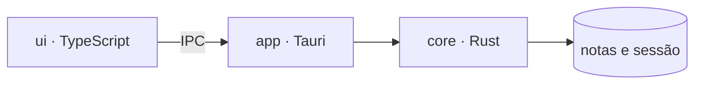
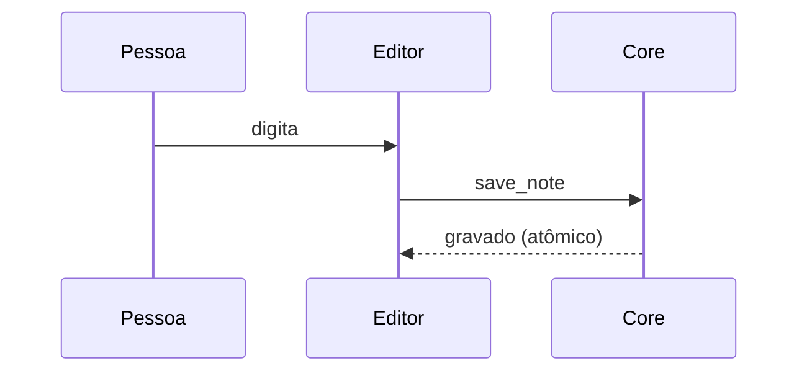

# Fullpad — tour pelo Markdown

> Este arquivo existe para você **ver** o que o Fullpad faz com Markdown. Abra-o e alterne entre as visões:
> `Ctrl+E` (renderizado ↔ código) e `Ctrl+Shift+E` (lado a lado). O texto nunca é reescrito: o que você vê é só uma *máscara* sobre o documento.

**Neste arquivo:** [Títulos](#títulos) · [Ênfase](#ênfase-e-texto-inline) · [Listas](#listas) · [Citações](#citações) · [Código](#blocos-de-código) · [Tabelas](#tabelas) · [Links e imagens](#links-e-imagens) · [Extras](#extras)

---

## Títulos

# H1 — Título de primeiro nível
## H2 — Título de segundo nível
### H3 — Título de terceiro nível
#### H4 — Título de quarto nível
##### H5 — Título de quinto nível
###### H6 — Título de sexto nível

Título estilo *setext* com sublinhado de `=`
=============================================

E outro, de segundo nível com `-`
---------------------------------

## Ênfase e texto inline

Texto com **negrito**, *itálico*, ***negrito e itálico***, ~~tachado~~ e `código inline`.
Também vale __negrito com sublinhados__ e _itálico com sublinhado_.

Misturando: **negrito com `código` dentro**, *itálico com [link](https://example.com) dentro* e ~~tachado com **negrito**~~.

Acentuação e símbolos: ação, coração, pão de queijo, çãõ, ñ, ü, “aspas curvas”, ‘simples’, — travessão, – meia risca, … reticências, © ® ™ § ¶ ° ± × ÷ ≈ ≠ ≤ ≥ ∞ π √.

Emoji direto no texto: 🚀 ✨ 📝 🧠 🇧🇷 👩‍💻 — o app conta posições em UTF-16, então nada desalinha.

Escapes: \*isto não é itálico\*, \`nem código\`, \# nem título, \[nem link\](x) e uma barra \\ invertida.

Quebra de linha forçada com dois espaços no fim:  
esta linha vem logo abaixo, no mesmo parágrafo.

Um parágrafo longo para ver a quebra automática de linha funcionando: Lorem ipsum dolor sit amet, consectetur adipiscing elit, sed do eiusmod tempor incididunt ut labore et dolore magna aliqua. Ut enim ad minim veniam, quis nostrud exercitation ullamco laboris nisi ut aliquip ex ea commodo consequat. Duis aute irure dolor in reprehenderit in voluptate velit esse cillum dolore eu fugiat nulla pariatur.

## Listas

### Não ordenada, com vários níveis

- Frutas
  - Cítricas
    - Laranja
    - Limão
    - Tangerina
  - Tropicais
    - Manga
    - Abacaxi
- Legumes
  - Raízes
    - Cenoura
    - Beterraba
- Grãos

### Ordenada

1. Preparar o ambiente
2. Instalar as dependências
   1. Rust
   2. Node
   3. pnpm
3. Rodar os testes
4. Gerar o instalador

### Mista

1. Primeira etapa
   - detalhe A
   - detalhe B
     1. sub-passo um
     2. sub-passo dois
2. Segunda etapa
   - detalhe C

### Lista de tarefas

- [x] Abrir o Fullpad
- [x] Criar uma nota
- [x] Fechar o app sem salvar (nada se perde)
- [ ] Reabrir e ver a nota no mesmo lugar
- [ ] Arrastar uma aba para fora da janela
  - [x] Soltar em uma janela nova
  - [ ] Dividir a janela em painéis

### Lista com parágrafos e blocos

1. Primeiro item, com um parágrafo explicativo.

   Segundo parágrafo do mesmo item, recuado.

   ```sh
   echo "código dentro de um item de lista"
   ```

2. Segundo item.

   > Uma citação dentro do item.

## Citações

> Uma citação simples.

> Uma citação de vários parágrafos.
>
> Este é o segundo parágrafo, ainda dentro da citação.
>
> — Alguém importante

> Citações aninhadas:
>
> > Segundo nível.
> >
> > > Terceiro nível, com **ênfase** e `código`.
>
> De volta ao primeiro nível.

> **Nota:** citações podem ter listas e código:
>
> - item um
> - item dois
>
> ```js
> const ok = true;
> ```

## Blocos de código

Bloco indentado (sem linguagem), com quatro espaços:

    function semLinguagem() {
      return "o app mostra como bloco de código mesmo assim";
    }

JavaScript:

```js
// Debounce: espera o usuário parar de digitar
export function debounce(fn, ms = 300) {
  let timer;
  return (...args) => {
    clearTimeout(timer);
    timer = setTimeout(() => fn(...args), ms);
  };
}

const salvar = debounce(async (texto) => {
  const resp = await fetch("/api/notas", {
    method: "POST",
    body: JSON.stringify({ texto, quando: Date.now() }),
  });
  console.log(`Salvo: ${resp.status}`);
}, 500);
```

TypeScript:

```ts
interface Nota {
  id: string;
  titulo: string;
  fixada?: boolean;
  etiquetas: readonly string[];
}

type Resultado<T, E = Error> = { ok: true; valor: T } | { ok: false; erro: E };

function buscar<T extends Nota>(notas: T[], termo: string): Resultado<T[]> {
  const achadas = notas.filter((n) => n.titulo.toLowerCase().includes(termo));
  return achadas.length ? { ok: true, valor: achadas } : { ok: false, erro: new Error("nada") };
}
```

Python:

```python
from dataclasses import dataclass, field
from collections import Counter

@dataclass(frozen=True)
class Palavra:
    texto: str
    contagem: int = field(default=1, compare=False)

def frequencia(texto: str, top: int = 5) -> list[tuple[str, int]]:
    """Conta as palavras mais comuns, ignorando maiúsculas."""
    palavras = (p.strip(".,;!?").lower() for p in texto.split())
    return Counter(p for p in palavras if len(p) > 3).most_common(top)

print(frequencia("O rato roeu a roupa do rei de Roma; o rei riu do rato."))
```

Rust:

```rust
use std::collections::HashMap;

#[derive(Debug, Clone, PartialEq)]
enum Token {
    Numero(f64),
    Operador(char),
    Parenteses { abre: bool },
}

fn tokenizar(entrada: &str) -> Result<Vec<Token>, String> {
    let mut saida = Vec::new();
    for c in entrada.chars().filter(|c| !c.is_whitespace()) {
        match c {
            '0'..='9' => saida.push(Token::Numero(c.to_digit(10).unwrap() as f64)),
            '+' | '-' | '*' | '/' => saida.push(Token::Operador(c)),
            '(' | ')' => saida.push(Token::Parenteses { abre: c == '(' }),
            outro => return Err(format!("caractere inesperado: {outro:?}")),
        }
    }
    Ok(saida)
}
```

C#:

```csharp
using System;
using System.Linq;
using System.Collections.Generic;

namespace Fullpad.Exemplos;

public record Nota(Guid Id, string Titulo, DateTime Criada, string[] Etiquetas);

public static class Busca
{
    public static IEnumerable<Nota> PorEtiqueta(IEnumerable<Nota> notas, string etiqueta) =>
        notas.Where(n => n.Etiquetas.Contains(etiqueta, StringComparer.OrdinalIgnoreCase))
             .OrderByDescending(n => n.Criada);

    public static async Task<int> ContarAsync(IAsyncEnumerable<Nota> fonte)
    {
        var total = 0;
        await foreach (var _ in fonte) total++;
        return total;
    }
}
```

SQL:

```sql
WITH vendas_mensais AS (
  SELECT date_trunc('month', v.data) AS mes,
         c.regiao,
         SUM(v.valor) AS total
    FROM vendas v
    JOIN clientes c ON c.id = v.cliente_id
   WHERE v.status <> 'cancelada'
   GROUP BY 1, 2
)
SELECT mes, regiao, total,
       total - LAG(total) OVER (PARTITION BY regiao ORDER BY mes) AS variacao,
       RANK()  OVER (PARTITION BY mes ORDER BY total DESC)        AS posicao
  FROM vendas_mensais
 ORDER BY mes, posicao;
```

CSS:

```css
:root {
  --cor-destaque: #4f8cff;
  --raio: 8px;
}

.cartao {
  display: grid;
  grid-template-columns: repeat(auto-fill, minmax(220px, 1fr));
  gap: 1rem;
  border-radius: var(--raio);
  box-shadow: 0 2px 8px rgb(0 0 0 / 0.15);
}

.cartao:hover > .titulo::after {
  content: " →";
  color: var(--cor-destaque);
}
```

HTML:

```html
<!doctype html>
<html lang="pt-BR">
  <head>
    <meta charset="utf-8" />
    <title>Olá, Fullpad</title>
  </head>
  <body>
    <main id="app" class="container" data-versao="1.1.0">
      <h1>Nada se perde</h1>
      <button type="button" onclick="alert('oi')">Clique</button>
    </main>
  </body>
</html>
```

YAML:

```yaml
nome: testes
on:
  push:
    branches: [main]
env: &padrao
  RUST_BACKTRACE: "1"
jobs:
  core:
    runs-on: ubuntu-latest
    env: *padrao
    steps:
      - uses: actions/checkout@v4
      - run: cargo test -p fullpad-core
```

Shell:

```bash
#!/usr/bin/env bash
set -euo pipefail

for arquivo in examples/example.*; do
  case "$arquivo" in
    *.md|*.json) echo "texto: $arquivo" ;;
    *.pdf|*.epub) echo "leitura: $arquivo" ;;
    *) echo "outro: $arquivo" ;;
  esac
done
```

JSON:

```json
{
  "nome": "fullpad",
  "versao": "1.1.0",
  "recursos": ["abas", "painéis", "live preview"],
  "ativo": true,
  "licenca": null
}
```

DBML:

```dbml
Table usuarios {
  id integer [pk, increment]
  nome varchar [not null]
  email varchar [unique]
}

Table notas {
  id integer [pk]
  autor_id integer [ref: > usuarios.id]
  texto text
}
```

Bloco de código sem linguagem declarada:

```
texto puro, sem destaque
    com recuo preservado
	e uma tabulação
```

## Tabelas

| Recurso            | Atalho            | Disponível | Observação                     |
| ------------------ | ----------------- | :--------: | ------------------------------ |
| Nova aba           | `Ctrl+N`          |     ✅     | Abre uma nota vazia            |
| Reabrir aba        | `Ctrl+Shift+T`    |     ✅     | Vem da lixeira                 |
| Dividir à direita  | `Ctrl+\`          |     ✅     | Cria um painel novo            |
| Visão lado a lado  | `Ctrl+Shift+E`    |     ✅     | Código e renderizado           |
| Zoom               | `Ctrl+roda`       |     ✅     | De 25% a 500%                  |
| Plugins            | —                 |     ❌     | Ainda sem planos               |

Alinhamentos: esquerda, centro e direita.

| Esquerda | Centro | Direita |
| :------- | :----: | ------: |
| a        |   b    |       c |
| texto    | texto  |   texto |
| 1        |   22   |     333 |

Tabela com formatação dentro das células:

| Estilo        | Exemplo                  |
| ------------- | ------------------------ |
| **Negrito**   | **forte**                |
| *Itálico*     | *suave*                  |
| `Código`      | `let x = 1;`             |
| Link          | [Rust](https://www.rust-lang.org) |
| ~~Tachado~~   | ~~errado~~               |

## Links e imagens

- Link simples: [Site do Rust](https://www.rust-lang.org)
- Link com título: [CodeMirror](https://codemirror.net "Editor de código para a web")
- Autolink: <https://tauri.app>
- URL solta (clicável com duplo clique ou Ctrl+clique): https://github.com
- E-mail: <contato@example.com>
- Link por referência: [documentação][docs] e [outra referência][ref-2]
- Âncora interna: [voltar ao início](#fullpad--tour-pelo-markdown)

[docs]: https://v2.tauri.app "Documentação do Tauri"
[ref-2]: https://pnpm.io

Imagem embutida (um SVG pequeno em data URI, que funciona sem rede):


## Extras

### Linha horizontal (três formas)

---

***

___

### HTML dentro do Markdown

<details>
<summary>Clique para expandir (HTML cru)</summary>

Dentro do <kbd>details</kbd> cabe **Markdown** também.

</details>

Texto com <mark>destaque</mark>, H<sub>2</sub>O, E = mc<sup>2</sup> e <kbd>Ctrl</kbd> + <kbd>S</kbd>.

<!-- Isto é um comentário HTML: não aparece no texto renderizado -->

### Notas de rodapé

O Fullpad guarda tudo em disco a cada pausa[^auto]. Fechar a janela nunca descarta o texto[^lixeira].

[^auto]: A gravação é atômica: escreve em um arquivo temporário e renomeia.
[^lixeira]: Notas fechadas vão para a lixeira e podem ser reabertas com `Ctrl+Shift+T`.

### Fórmulas e diagramas em texto

Equação em texto simples: `E = m · c²` e `∑ᵢ xᵢ / n`.

```text
┌──────────┐     ┌──────────┐
│   core   │ ◀── │   app    │
│ (Rust)   │     │ (Tauri)  │
└──────────┘     └────┬─────┘
                      │ IPC
                 ┌────▼─────┐
                 │    ui    │
                 └──────────┘
```

### Diagramas Mermaid

Um bloco `mermaid` fechado vira diagrama (com o cursor dentro dele, aparece o código):





### Definições e termos

Termo
: Definição (nem todo renderizador entende esta sintaxe, e o Fullpad mantém o texto como está).

### Fim

Se você chegou até aqui, viu títulos, ênfases, listas (inclusive de tarefas), citações aninhadas, **11 linguagens de código**, tabelas alinhadas, links de vários tipos, imagem embutida, HTML, notas de rodapé e diagramas em texto. Para exportar: **Arquivo ▸ Exportar** (HTML, PDF ou copiar como HTML).
